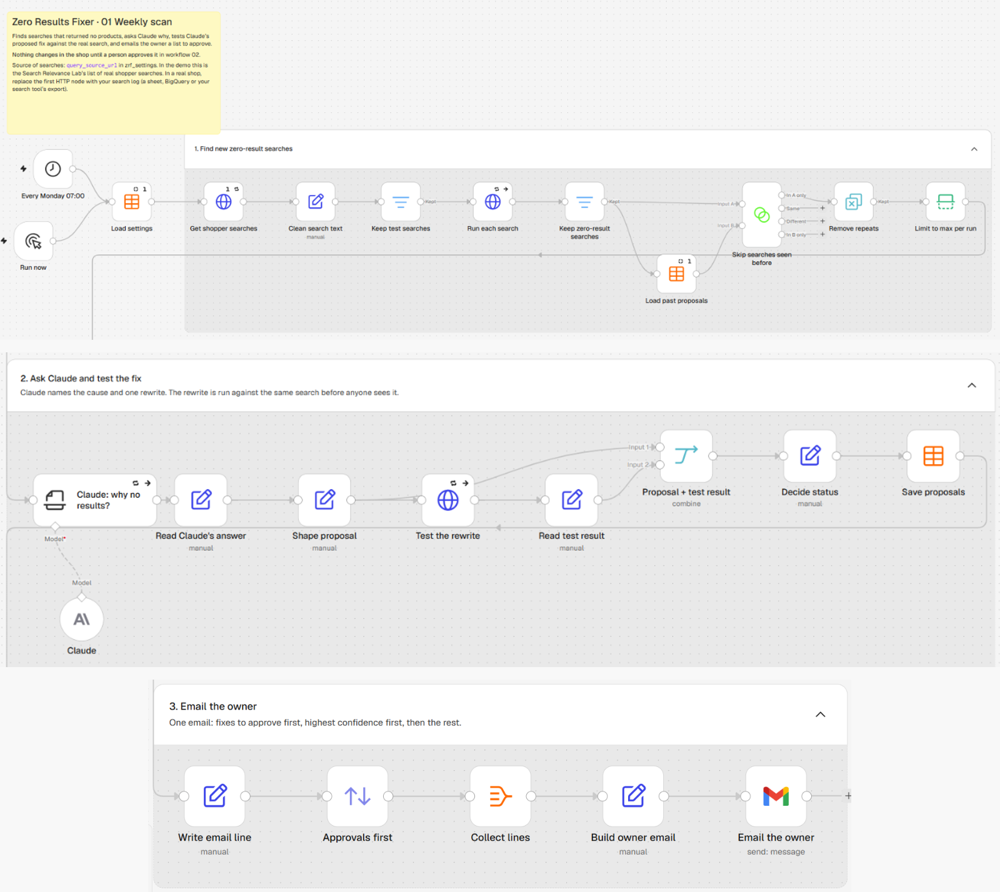

# Zero Results Fixer

**An n8n workflow that finds shop searches with no results, has Claude explain why and propose a fix, tests the fix, and lets a person approve it before anything changes.**

**Current version:** 0.3.0



Demo video (41 seconds, recorded in n8n Cloud): [kostasxeras.com/projects/zero-results-fixer.html#demo](https://kostasxeras.com/projects/zero-results-fixer.html#demo)

## Why this exists

When a shopper searches and sees "No results found", the shop has usually lost that sale. Most of these searches are not for products the shop lacks. They are misspellings, brand names, model numbers or wording the catalogue does not use. In my day job in product search, cutting "No results found" searches was one of the clearest wins we had.

Fixing them by hand is slow: someone has to export the searches, guess the reason, try a rewrite and add a synonym rule. This workflow does the slow parts and leaves the decision with a person.

## What it does

Every Monday:

1. **Finds** searches that returned no products (workflow 01).
2. **Asks Claude** for the most likely cause (spelling, wording, brand or collection, too specific, not sold, not a product search) and one rewritten search.
3. **Tests the rewrite** against the same search engine. Rewrites that still find nothing are dropped before anyone sees them.
4. **Emails the owner** a list of tested fixes, each with the products it now finds and a one-click review link.
5. **The owner approves, edits or rejects** each fix in a form (workflow 02). Approved fixes become rules.
6. **The shop's search reads the rules** from a JSON endpoint (workflow 03).
7. **A weekly report** sums up causes, decisions and searches for things the shop may not sell (workflow 04).

Nothing changes in the shop until a person approves it.

## Demo data

The demo runs against my [Search Relevance Lab](https://github.com/costasxeras-stack/search-relevance-lab), which uses the open WANDS dataset (42,994 furniture products and real shopper searches). With strict keyword search, 60 of the 192 held-out test searches return no products. Those 60 are this workflow's input. In a real shop you replace the first HTTP node with your own search log.

## Status

- **Tested:** 19 of 19 scenarios passed in a local n8n 2.47.7, with stand-ins for Claude and email. See [docs/testing.md](docs/testing.md).
- **Run live:** on 20 November 2026 it ran on n8n Cloud with the real Claude over all 60 searches. 46 got a tested fix that returns products.
- **Main finding:** scored against human relevance labels, Claude's fixes did worse than a simple non-AI fix (let the original search match any word): mean nDCG@10 0.566 against 0.642. Details and caveats in the [case study](docs/case-study.md).

## Workflows

| File | What it does |
|---|---|
| `workflows/00-setup.json` | Run once. Creates the data tables and a settings row |
| `workflows/01-weekly-scan.json` | Finds zero-result searches, asks Claude, tests fixes, emails the owner |
| `workflows/02-review-form.json` | The owner's approve / edit / reject form |
| `workflows/03-rules-api.json` | Returns approved rules as JSON for the shop's search |
| `workflows/04-weekly-report.json` | Weekly summary email |
| `workflows/99-error-alerts.json` | Emails the owner when any run fails |

Setup takes about 30 minutes: [docs/setup-guide.md](docs/setup-guide.md).

## How it was built

I framed the problem, chose the guardrails (test before asking, a person approves every fix, one decision per link) and wrote the documentation. Claude (Anthropic) was my engineering partner for building and testing the workflows. Decisions are in [docs/decisions](docs/decisions).

## Repo layout

```
workflows/              Six n8n workflow files to import
docs/setup-guide.md     Step by step, about 30 minutes
docs/testing.md         19 test scenarios and results
docs/case-study.md      Question, approach, live results, what is confirmed and what is not
docs/data/              Every search and result from the live run (CSV)
scripts/                Scores the live run against the relevance labels
docs/product-brief.md   Users, goals, scope
docs/decisions/         One record per real trade-off
docs/screenshots/       Workflow and form screenshots
```
